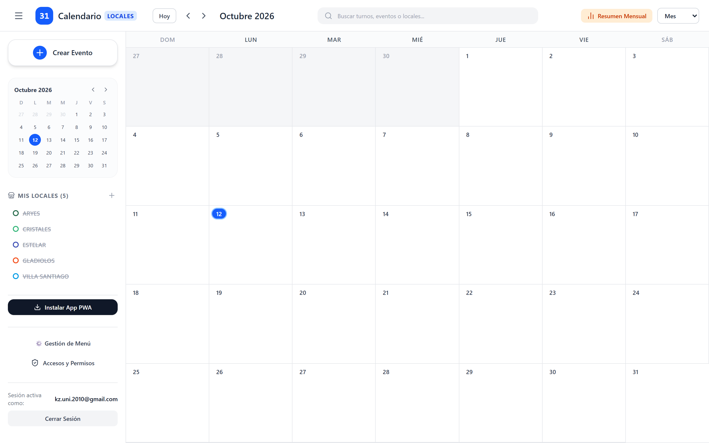
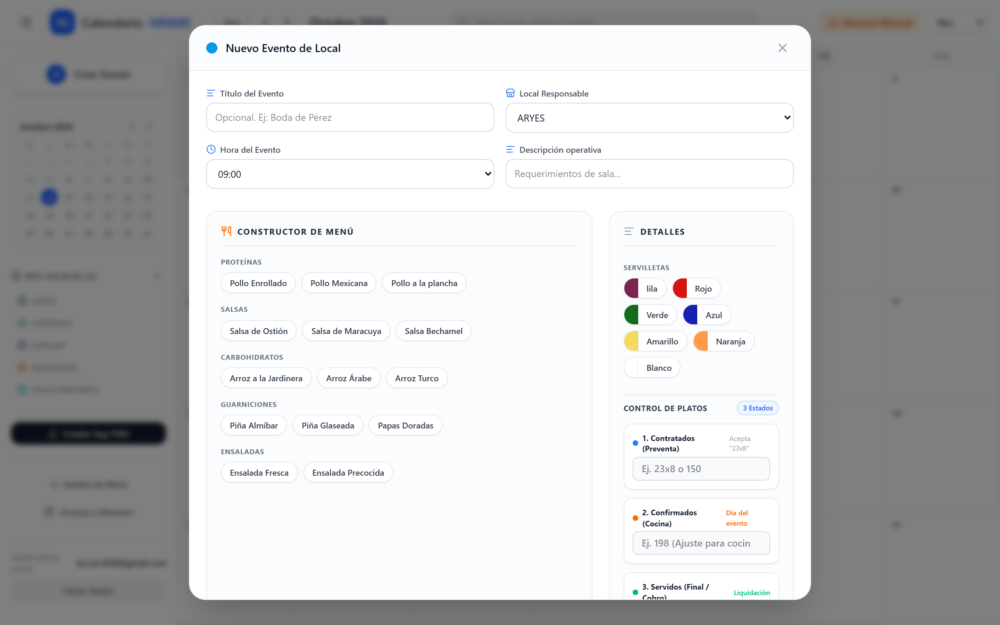
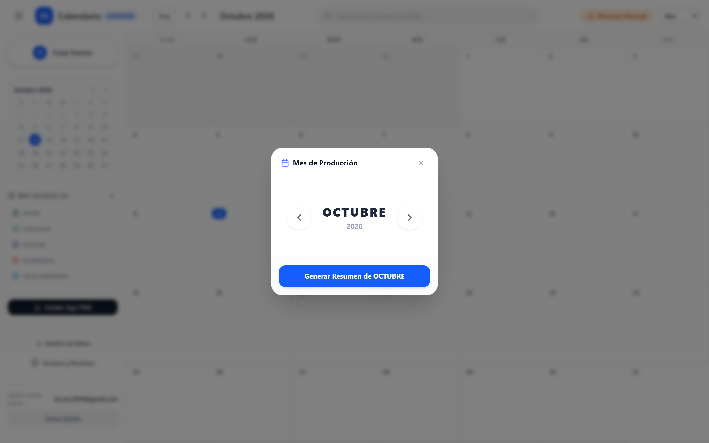
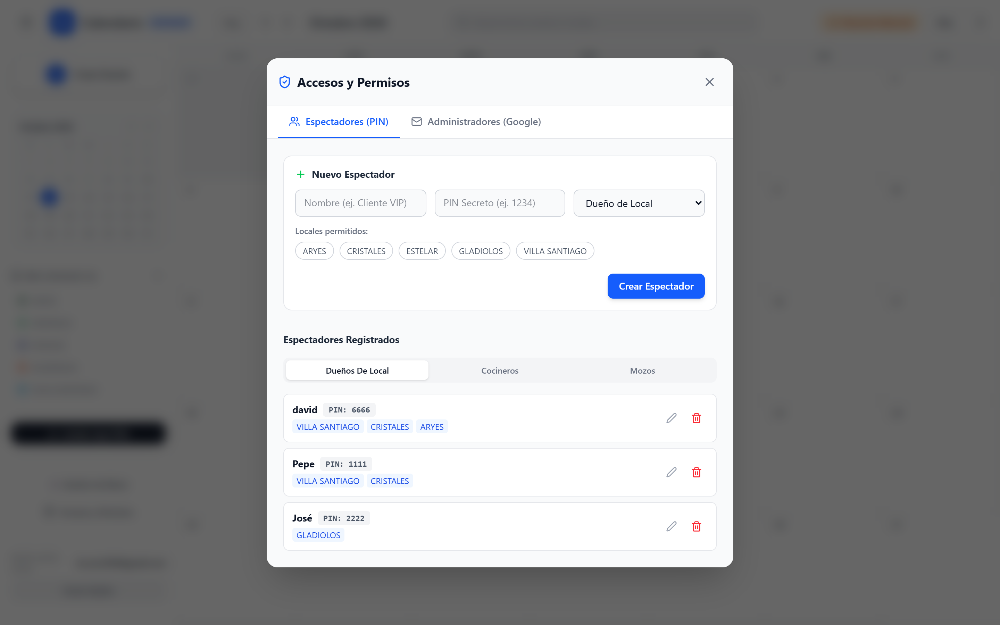
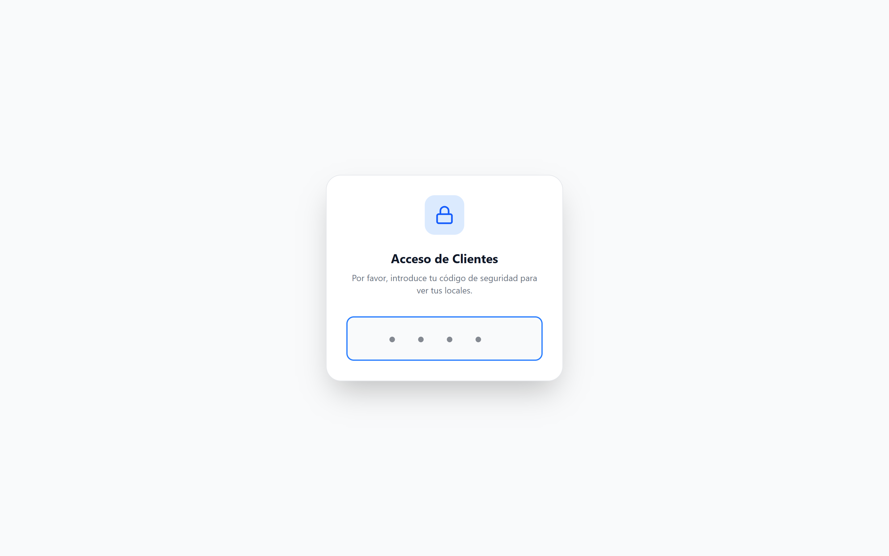
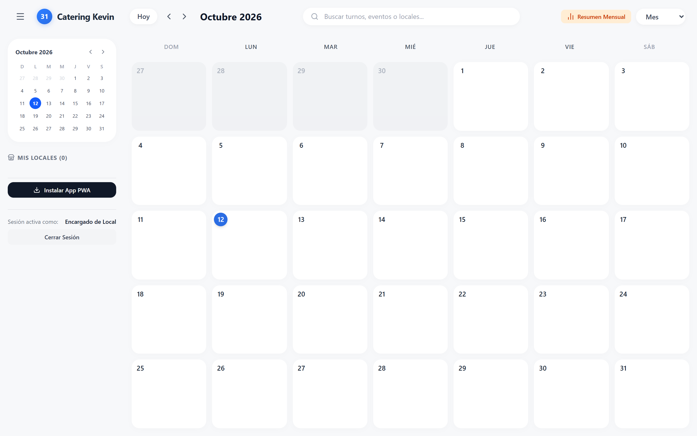

<!-- _class: lead -->
# 📘 Manual de Usuario en Diapositivas
### Guía Visual de Operación y Capacitación del Sistema

**Sistema:** Calendario de Locales y Gestión de Catering  
**Responsable Técnico:** Kevin Zambrano  
**Versión:** 1.0 (Producción)  

---

## 🗺️ 1. Estructura de Accesos y Roles

El sistema cuenta con **dos puertas de entrada** según el rol del usuario:

### 1. Panel Administrador (`/admin`)
* **URL:** `tu-dominio.vercel.app/admin`
* **Acceso:** Google OAuth (cuentas autorizadas en Lista Blanca).
* **Funciones:** Crear, editar y borrar eventos, gestionar catálogo de menús, ver Resumen Mensual de platos y asignar PINs a locales.

### 2. Portal de Clientes / Locales (`/`)
* **URL:** `tu-dominio.vercel.app/`
* **Acceso:** PIN de seguridad de 4 dígitos.
* **Funciones:** Consulta de eventos del local asignado en modo solo lectura.

---

## 🔑 2. Paso 1: Ingreso del Administrador

1. Ingrese desde el navegador a la dirección terminada en `/admin`.
2. Presione el botón **"Iniciar sesión con Google"**.
3. Seleccione su cuenta de correo autorizada en la lista blanca (`admin_emails`).
4. El sistema validará su identidad y cargará el panel de control administrativo.

> **Seguridad:** Si un correo no registrado intenta ingresar, el sistema denegará el acceso automáticamente informando que no pertenece a la Lista Blanca.

---

## 🖥️ 3. Paso 2: Recorrido por el Panel Administrador

* **Botón "+ Crear Evento":** Ubicado en la barra lateral superior.
* **Filtro de Locales:** Lista en la barra izquierda (*Aryes, Cristales, Estelar, Gladiolos, Villa Santiago*).
* **Resumen Mensual:** Botón naranja para ver el histograma de producción de cocina.

---

## 📝 4. Paso 3: Cómo Crear un Evento y Pedido de Catering

1. Pulse **"+ Crear Evento"** o haga clic en el día deseado del calendario.
2. Complete la información básica (Título, Local, Horas en Perú UTC-5).
3. Complete el **Control de Platos (3 Estados)**:
   - **Contratados:** Acepta fórmulas como `23x8` (calcula 184 platos en vivo) o número directo.
   - **Confirmados:** Ajuste del día para cocina.
   - **Servidos:** Conteo final en sala para liquidación.
4. Seleccione la Proteína, Guarnición, Ensalada, Salsa y Servilletas.
5. Presione **"Guardar Evento"**. Se sincroniza en tiempo real en la base de datos.

---

## ✏️ 5. Paso 4: Cómo Modificar o Eliminar Eventos

* **Para Modificar:** Haga clic sobre el evento en el calendario -> pulse **"Editar"** -> ajuste los platos u horario -> pulse **"Guardar"**.
* **Para Eliminar:** Abra el evento -> pulse el botón rojo **"Eliminar"** -> confirme la acción.

---

## 📊 6. Paso 5: El Módulo "Resumen Mensual" para Cocina

* Cada barra vertical representa un día del mes con el total de raciones para cocina.
* **Impacto en Compras:** Permite al jefe de cocina comprar insumos con antelación matemática, **reduciendo el desperdicio de comida**.

---

## 🍽️ 7. Paso 6: Configuración del Catálogo de Menú

* En la barra lateral izquierda, abra **"Gestión de Menú"**.
* Active o agregue opciones para Proteínas, Carbohidratos, Ensaladas y Salsas.

---

## 👥 8. Paso 7: Creación de Espectadores y Asignación de PINs

1. En la barra lateral izquierda, abra **"Accesos y Permisos"**.
2. Ingrese el **Nombre del Encargado** y defina un **PIN de 4 dígitos** (ej. `3791`).
3. Marque las casillas de los **Locales Permitidos** que este usuario podrá ver.
4. Presione **"Crear Espectador"**.

---

## 🔢 9. Paso 8: Ingreso del Cliente o Sede con PIN

1. El encargado ingresa a la dirección web principal: `tu-dominio.vercel.app/`.
2. Digita su **código de seguridad de 4 dígitos**.
3. El sistema valida automáticamente el PIN sin presionar enter.
4. **Protección Anti-Fuerza Bruta:** Tras 5 intentos fallidos, el teclado se bloquea por 30 segundos.

---

## 📱 10. Paso 9: Consulta en Celulares y Tablets

* **Alternar Vista Mes / Agenda:** En la esquina superior derecha, seleccione **"Agenda"** para ver los eventos en lista vertical adaptada a celulares.
* **Modo Solo Lectura:** El personal puede consultar notas y menús sin riesgo de borrar datos.

---

## ❓ 11. Preguntas Frecuentes y Buenas Prácticas

* **¿Qué hacer si un encargado olvida su PIN?**
  * El administrador ingresa a `/admin` -> *Accesos y Permisos* -> busca al usuario y le cambia el PIN en 5 segundos.
* **¿Cómo cerrar sesión en equipos compartidos?**
  * Pulse **"Cerrar Sesión"** en la esquina inferior izquierda para borrar los datos temporales del equipo.
* **¿Qué pasa si se corta el internet temporalmente?**
  * La aplicación cuenta con caché local y continuará mostrando los eventos sincronizados previamente.

---

<!-- _class: lead -->
# ✨ ¡Capacitación Concluida!
### El equipo está listo para operar la plataforma con máxima eficiencia

**Soporte Técnico:** Kevin Zambrano  
**Contacto:** `kevin.zambrano.inteligencia@gmail.com`  

*¿Deseas practicar creando tu primer evento de prueba?*
